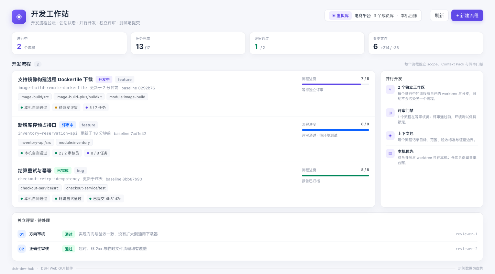
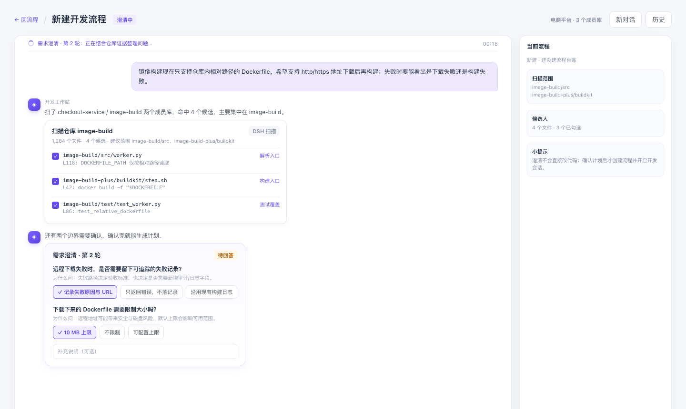
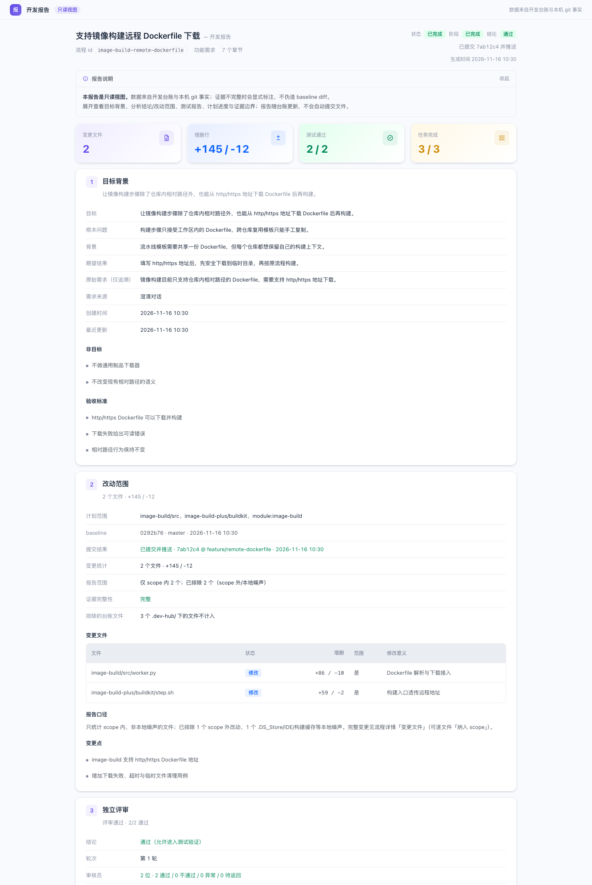

<p align="center">
  
</p>

<h1 align="center">dsh-dev-hub</h1>

<p align="center">
  <strong>Chat-first development flows for DeepSeek Harness.</strong><br />
  Turn one sentence of intent into a scoped, reviewable, testable and reportable delivery.
</p>

<p align="center">
  <a href="#quick-start">Quick start</a> ·
  <a href="#how-it-works">How it works</a> ·
  <a href="#screenshots">Screenshots</a> ·
  <a href="README.zh-CN.md">中文</a> ·
  <a href="CHANGELOG.md">Release notes</a> ·
  <a href="LICENSE">Apache-2.0</a>
</p>

---

`dsh-dev-hub` is a [DeepSeek Harness](https://github.com/deepseek-ai/deepseek-harness) Web GUI plugin. It sits between a rough product request and a coding session, and keeps the boring but important parts honest:

- what exactly are we changing, and what are we **not** changing?
- which files are in scope, and which changes belong to someone else?
- what evidence proves the work is done?
- is a second pair of eyes required before tests and delivery?

The plugin is repository-agnostic. It can target a single Git repository, or a **virtual workspace** composed of several repositories.

> The UI is currently Chinese-first. All names, repositories and numbers in the screenshots are fictional sample data.

## Why

A coding agent can write code quickly. The expensive parts are usually around it:

- the request is ambiguous, so the agent guesses;
- the change quietly spills into unrelated files;
- two flows run in the same working tree and contaminate each other;
- “tests passed” is claimed, but nobody can see which command, where, or when;
- the final hand-off is a chat transcript, not a reviewable artifact.

`dsh-dev-hub` turns those into first-class flow state: **scope, evidence, review gate, isolated working tree, and a report**.

## Screenshots

### Development workbench


A workspace-level view of active flows, task progress, review state and parallel work. An active flow can own its own worktree and branch, so two flows in the same repository cannot see or overwrite each other's changes.

### Requirement clarification



Start with a sentence. The workstation scans the repository, shows candidate files with matched lines, and asks only the questions that change the implementation or acceptance criteria. No estimate forms, no fields for “person-days”.

### Development report



Every finished flow can produce a read-only report: goal, scope, review verdicts, tests, plan, timeline and evidence boundary. The report excludes out-of-scope changes and local noise such as `.DS_Store`, and says so explicitly.

[Open the full report screenshot](docs/assets/screenshots/development-report-full.png)

## Features

### Clarification workspace

- A dedicated **Requirement clarification** tab manages drafts before they become flows.
- Each draft shows whether it is being scanned, waiting for answers, has a plan to confirm, or is a reusable draft.
- Users can resume, start a new clarification, or delete a draft without touching code or created flows.
- An empty workbench starts with a three-step onboarding card instead of dropping users into a blank flow list.

### Chat-first requirement intake

- Scan a repository before asking questions.
- Rank candidate files and show the exact matched lines.
- Clarify in multiple rounds; every question explains **why it is being asked**.
- Generate a plan with steps, acceptance criteria, risks and a read-only estimate.
- Create the flow only after the user confirms the plan.

### Repository-aware context

- Scope tokens such as `src/main/java/...` or `module:checkout`.
- A Context Pack with goal, non-goals, acceptance criteria, task state, evidence and local environment.
- Per-repository conventions in `.dev-hub/conventions.json`.
- Optional multi-repository **virtual workspaces** with equal-weight members.

### Worktree isolation

- Every git development flow gets its own git worktree by default, so main-worktree changes, build output and other flows never leak into its change list.
- Virtual workspaces create one worktree per git member repository.
  - branch: `devhub/<flow-id>` or `devhub/<flow-id>--<member>`
  - directory: `~/.dsh/dev-hub/worktrees/<repo-hash>/<id>` (derived locally, never written into the repository)
- The ledger stays in the main repository (or the workstation-local ledger directory for virtual workspaces); only code lives in the worktree.
- On submission, the workstation pushes the worktree commit back to the **branch the flow started from** (or a new branch if explicitly selected), rebasing onto the latest remote tip when needed.
- **Sync before development:** the flow header has a `Fetch code` action that runs `git fetch --all --prune` and `git merge --ff-only @{u}` for the target repository (or every member of a virtual workspace). The chat plan card has a default-on "fetch latest code before starting" checkbox. Worktrees are created from the updated HEAD; dirty or diverged repositories fail visibly instead of being rebased/reset automatically.

### Session management

The workstation creates several kinds of DSH sessions: the development session bound to a flow, independent reviewer sessions, and scan/clarification subagents. The **Sessions** tab groups them by purpose:

- The page follows the **project selected in the top bar**; switching repository/virtual workspace switches the managed sessions. It does not render every project at once.
- The page only manages sessions **created by the workstation and linked to a requirement**: development, review, clarification and scan sessions under each flow. External DSH sessions, unbound sessions and unlinked historical sessions are not rendered.
- The default **By project** view shows `project workspace → requirement → sessions`.
- A **By category** view keeps the flat Development / Review / Scan / Clarification / Other internal / Unbound / Other grouping.
- Shows live/running/archived/pinned state, workspace, flow/reviewer ownership, cwd, event count and a short preview.
- Actions: open a session, **expand its conversation inline** (live and persisted sessions both work), archive/unarchive (archiving hides it from Workspace grouping and keeps the log; running sessions stop first), and pin/unpin. Opening or inspecting a session does not create a Workspace.
- Scan/clarification/internal groups can be archived in bulk.

Each dev-hub project (a single repository or a virtual workspace) automatically gets a persistent DSH **project workspace** titled `DevHub · <project>`: the repository path for a single repo, or the local ledger directory for a virtual workspace. Sessions whose `cwd` is that project path (scan/clarification/requirement/internal tasks) are attached automatically; the page shows and opens these project workspaces.

DSH Workspace membership is keyed by an exact canonical session `cwd`, so a development or review session running inside a per-flow git worktree remains in that worktree's own DSH workspace. The Sessions page is project-aware and groups those sessions back under their flow/project, with open/expand/archive/pin actions.

Host APIs: `GET/POST /api/dev-hub/sessions/manage` (POST actions: `archive`, `unarchive`, `pin`, `unpin`) and `GET /api/dev-hub/session-transcript?sessionId=…` for inline transcripts.

### Review before verification

- Dispatch 1–3 independent reviewer sessions with different perspectives:
  - direction: does this solve the agreed problem?
  - correctness: edge cases, failures and test coverage.
  - risk: compatibility, data, security, rollback, operability.
- Review is a gate: environment tests and submission stay locked until review passes.
- Failed review turns into explicit correction items, not “looks good to me”.

### Tests, submission and reports

- Run local and environment test commands through the Host.
- Record command, output, duration, author and result.
- Select changed files, commit and push from the workstation.
- Generate a Markdown/HTML report with fixed sections:
  - goal and background;
  - change scope and evidence;
  - independent review;
  - tests;
  - plan and progress;
  - timeline;
  - evidence boundary.

### Localization

- UI copy is rendered through DSH's client locale service as the `dev-hub` namespace; the language is still switched under **Settings → General → Language**.
- Language resources are pluggable: one `locale/<id>.json` per language carries plugin metadata (`meta.title` / `meta.description`), the language definition (`language.label` / `language.fallback`), the UI dictionary (`messages`, keyed by the Chinese source text) and dynamic templates (`templates` / `templateValues`).
- `messages` now covers static Chinese literals in `src/client` plus the shared labels/status/gate copy rendered by the client (about 1,080 entries); `templates` covers every Chinese-interpolating template literal in `src/client` (about 330 entries). `npm test` scans source literals and template literals, asserts shared label tables are in the dictionary, and renders the home/detail/wizard/status pill to check no Chinese interface copy remains under `en`.
- The Host reads `locale/*.json` at runtime and serves it over the loopback `GET /api/dev-hub/locales` route; the browser then registers it with DSH locale. Adding a language needs no change to `src/client` components and no rebuild of `lib/client.js`.
- The browser reads DSH's actual locale catalog: languages already registered by the Host are not passed to `addLanguage` again; only the `dev-hub` namespace dictionary is added (this machine's DSH 0.2.0-rc.2 ships only `zh`/`en`; other versions may register more). Variants such as `fr-CA` may fall back to an already-registered `fr`.
- Workbench chrome, navigation, chat controls, review labels and report controls follow the active locale. Host-generated prose, repository names and user-authored report content keep their original language.
- New UI strings: add the key to `messages` in both `locale/zh.json` and `locale/en.json`; the key sets must stay complete and aligned (`npm test` enforces it).
- New language: copy `locale/en.json` to `locale/<id>.json`, keep/adjust `meta`, set `language.label` to the language's own name (e.g. `日本語`), optionally set `language.fallback` (defaults to `en`, and the whole chain must terminate at `en`), then translate `messages`. `templates` / `templateValues` are optional; without them, dynamic counters/status copy falls back to the English templates. Refresh the page and pick the language in Settings.

Dictionary shape:

```json
{
  "meta": { "title": "开发工作站", "description": "..." },
  "language": { "label": "中文" },
  "messages": { "开发工作站": "开发工作站", "独立评审": "独立评审" },
  "templates": { "任务 {done}/{total}": "任务 {done}/{total}" },
  "templateValues": { "通过": "通过" }
}
```

A third-party language still requires `meta` (a file without it is discarded), plus its own messages:

```json
{
  "meta": { "title": "開発ワークステーション", "description": "..." },
  "language": { "label": "日本語", "fallback": "en" },
  "messages": { "开发工作站": "開発ワークステーション" },
  "templates": { "任务 {done}/{total}": "タスク {done}/{total}" },
  "templateValues": { "通过": "合格" }
}
```

If a dictionary fails to parse, `zh`/`en` keys or templates drift apart, or a language id/fallback chain is invalid, the Host returns `errors` in the payload and the browser re-checks it against the real catalog and logs an explicit warning. The remaining valid languages still load and the UI falls back to the Chinese source text instead of blanking out.

### Local-first

- Developer identity and environment probes live in `~/.dsh/dev-hub/profile.json`.
- Worktrees live outside the repository.
- The report and ledger are plain files; no proprietary service is required.
- Network calls only happen through the configured DSH model route when scanning, clarifying or reviewing.

## How it works

```mermaid
flowchart LR
  U[User: one sentence] --> C[Chat / requirement intake]
  C --> S[Repository scan]
  S --> Q[Clarification questions]
  Q --> P[Plan + acceptance criteria]
  P --> F[Create flow]
  F --> W[Isolated worktree / branch]
  W --> D[Development session]
  D --> R[Independent review]
  R -->|passed| T[Local + environment tests]
  R -->|failed| D
  T --> G[Git commit + push]
  G --> RP[Development report]
```



The browser half is a React UI mounted through DSH Web GUI slots. The host half is a Cordis plugin that registers loopback `/api/dev-hub/*` routes and DSH tools. Core logic lives in `src/core/` and is deliberately framework-free so it can be tested as pure functions.

```text
src/
  core/      flow state, scope, context, review, reports, worktrees
  host/      DSH agents, session state, pending questions
  client/    React workbench, chat, report view
  shared/    API and workflow contracts used by both halves
```

## Quick start

### Requirements

- DeepSeek Harness Desktop or Web GUI, 0.2.x
- Node.js `^22.19.0` or `>=24.0.0`
- Git
- A DSH profile with a working model route

### Install from source

```bash
git clone <your-repo-url> dsh-dev-hub
cd dsh-dev-hub
npm install
npm run build

# Replace <profile> with the DSH profile you use (for example: web or desktop)
dsh plugin --profile <profile> add link:"$(pwd)"
```

Restart DSH after installing or updating the **host** half. Client code can hot-reload when `dsh web`/the DSH dev watcher is running.

Open the DSH Web GUI, then choose **开发工作站 / Development Workstation** from the left panel list.

### First run

1. Pick a repository, or create a virtual workspace from two or more repositories.
2. Enter your local display name. It is stored only on this machine.
3. Let the workstation probe the local environment.
4. Describe what you want to build in one sentence.
5. Confirm the scanned files, answer clarification questions, approve the plan.
6. Let the development session implement; review it; run tests; submit; read the report.

## Data layout

| Data | Location | Shared? |
| --- | --- | --- |
| Repository flow ledger, conventions, reports | `<repo>/.dev-hub/` | Commit the parts your team wants to share |
| Local identity and environment cache | `~/.dsh/dev-hub/profile.json` | No |
| Virtual workspace ledger | `~/.dev-hub/workspaces/<workspace-id>/` | No |
| Worktrees | `~/.dsh/dev-hub/worktrees/<repo-hash>/<flow-id>` | No |
| Generated local reports | `<repo>/.dev-hub/reports/` or virtual workspace `reports/` | Optional |

A virtual workspace is a local composition of existing repositories. It does not copy code into a hidden directory and it does not write a private ledger into any member repository.

## Development

```bash
npm run build       # build host + client bundles
npm run typecheck   # TypeScript check
npm test            # node:test suite
```

The repository is intentionally small and dependency-light. Core modules should remain free of DSH host imports so they can be tested without a running harness.

## Security and privacy

- Host routes are loopback-only.
- The plugin does not upload source code to a third-party service; model calls go through the DSH model route configured by the user.
- Shell commands are taken from repository/project configuration and executed through the Host. Review them before running a flow on an untrusted repository.
- Do not commit `.dev-hub/` if your ledger contains private customer names, internal URLs or local paths.

## Limitations

- Every static Chinese literal and Chinese-interpolating template literal in `src/client` is dictionary/template-backed; a language pack that omits templates falls back to the English ones. Host-generated prose, repository names and user content stay in their authored language.
- Third-party language copy is maintained by the dictionary author; missing keys fall back to English. Dictionaries are fetched asynchronously on page load, so the first frame may briefly show the Chinese source text.
- Virtual workspaces are a local composition, not a remote repository service.
- Worktree isolation applies to Git repositories, not to virtual workspace local ledgers.
- Test and review quality still depends on the configured model and the repository's own commands.

## Release notes

See [CHANGELOG.md](CHANGELOG.md) for user-visible changes.

## Contributing

Issues and pull requests are welcome. Please keep changes scoped, add tests for core behavior, and include a short evidence note in the PR (what changed, how it was verified).

## License

Apache-2.0. See [LICENSE](LICENSE).
