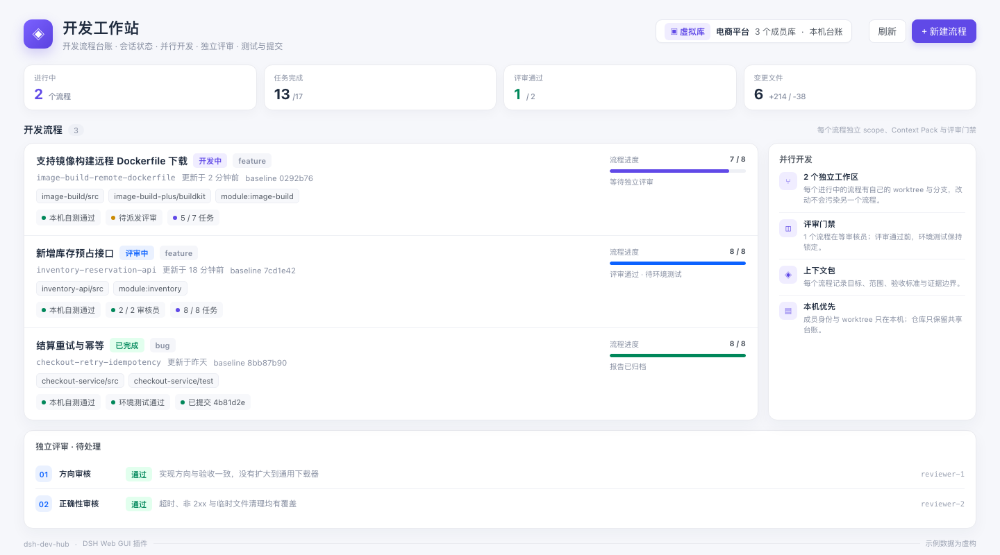
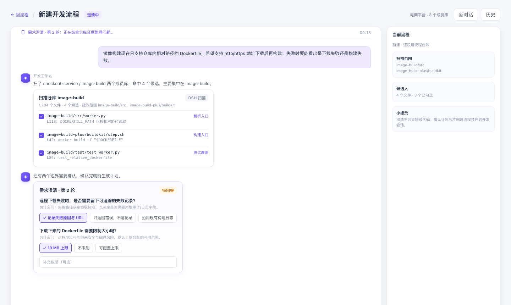
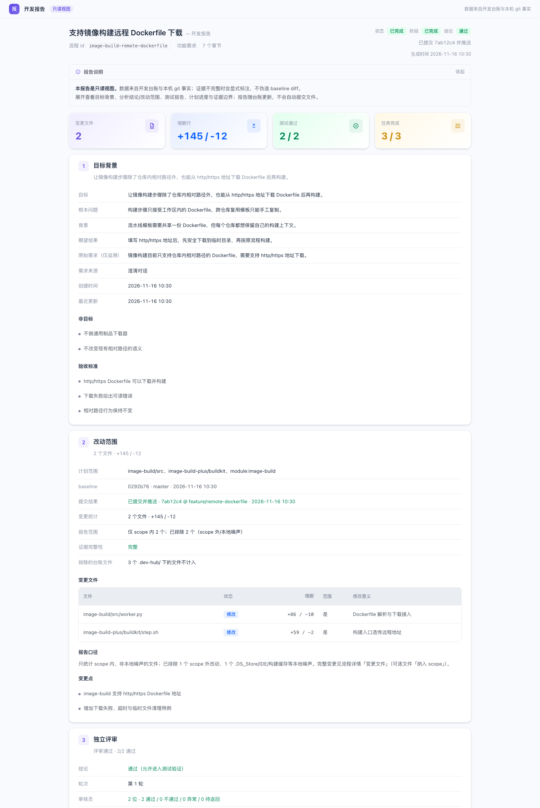

<p align="center">
  
</p>

<h1 align="center">dsh-dev-hub</h1>

<p align="center">
  <strong>面向 DeepSeek Harness 的对话式开发流程工作站。</strong><br />
  从一句话需求，到有范围、有评审、有测试、有报告的一次完整交付。
</p>

<p align="center">
  <a href="#快速开始">快速开始</a> ·
  <a href="#工作方式">工作方式</a> ·
  <a href="#截图">截图</a> ·
  <a href="README.md">English</a> ·
  <a href="CHANGELOG.zh-CN.md">更新日志</a> ·
  <a href="LICENSE">Apache-2.0</a>
</p>

---

`dsh-dev-hub` 是一个 [DeepSeek Harness](https://github.com/deepseek-ai/deepseek-harness) Web GUI 插件。它位于“模糊需求”和“开发会话”之间，把开发过程中容易被忽略、但决定交付质量的部分变成流程事实：

- 这次到底要改什么、**不改什么**？
- 哪些文件属于本流程，哪些改动其实是别人的？
- 有什么证据证明工作真的完成了？
- 测试和交付之前，是否必须经过独立评审？

插件不绑定具体代码库：可以面向单个 Git 仓库，也可以面向由多个仓库组成的**虚拟库**。

> 当前界面以中文为主。截图中的仓库、人名、数字均为虚构示例。

## 为什么需要它

代码可以由 Agent 快速写出来，真正昂贵的通常是代码之外的部分：

- 需求含糊，Agent 只能猜；
- 改动悄悄溢出到无关文件；
- 两条流程共用一个工作区，互相污染；
- “测试通过”只是聊天里的一句话，看不到命令、环境、时间和输出；
- 最终交接是一段聊天记录，而不是一份可复核的交付物。

`dsh-dev-hub` 把这些变成流程状态：**范围、证据、评审门禁、隔离工作区和报告**。

## 截图

### 开发工作站


在同一个工作区视图里查看进行中的流程、任务进度、评审状态和并行开发。进行中的流程可以拥有独立 worktree 与分支，因此同一仓库的两条流程不会互相看到或覆盖对方的改动。

### 需求澄清



只需要说一句话。工作站先扫描仓库，给出候选文件和命中行，再只问那些真正影响实现或验收的问题。没有“规模/人天”输入框，也没有一长串表单项。

### 开发报告



每个完成的流程都可以生成一份只读报告：目标、改动范围、评审结论、测试、计划、时间线和证据边界。报告会自动排除 scope 外改动与 `.DS_Store` 等本地噪声，并明确写出排除口径。

[查看完整报告截图](docs/assets/screenshots/development-report-full.png)

## 功能

### 需求澄清工作区

- 独立的「需求澄清」页签，统一管理还没变成流程的需求草稿；
- 每张卡片标明：正在扫描、等待回答、计划待确认，还是普通草稿；
- 可以直接继续澄清、新建澄清、删除草稿，不会影响代码或已创建的流程；
- 空工作区首屏用三步引导代替空白流程列表，新用户知道先从一句话开始。

### 对话式需求入口

- 先扫描仓库，再提问；
- 候选文件带命中行，便于二次确认；
- 多轮澄清，每个问题都解释“为什么问”；
- 自动生成步骤、验收标准、风险与只读工程量自评；
- 用户确认计划后才创建流程。

### 仓库感知的上下文

- 支持 `src/main/java/...` 这样的目录范围，也支持 `module:checkout` 模块范围；
- Context Pack 包含目标、非目标、验收、任务状态、证据和本机环境；
- 每个仓库的规范保存在 `.dev-hub/conventions.json`；
- 支持多个代码库平权组成的**虚拟库**。

### Worktree 隔离

- 第一条进行中的流程可以使用主工作区；
- 当已有其他进行中的流程时，后续流程自动获得独立 worktree 与分支：
  - 分支：`devhub/<flow-id>`
  - 目录：`~/.dsh/dev-hub/worktrees/<repo-hash>/<flow-id>`
- 台账仍在主仓库；代码改动互相隔离。
- 提交时默认把 worktree 提交推回**开工时所在的分支**（用户显式选择新分支时除外）；远端分支前进时会先自动 rebase，不需要用户手工合并 `devhub/<flow-id>`。

### 测试验证前的独立评审

- 派发 1~3 位审核员，按不同视角独立复核：
  - 方向：是否解决约定好的问题；
  - 正确性：边界、失败路径与测试覆盖；
  - 风险：兼容性、数据、安全、回滚与可观测性。
- 评审是门禁：评审通过前，环境测试与提交保持锁定；
- 评审不通过会转成明确的纠偏项，而不是一句“看起来没问题”。

### 测试、提交与报告

- 通过 Host 执行本机自测与环境测试；
- 记录命令、输出、耗时、执行人和结果；
- 在流程内选择变更文件、提交并推送；
- 生成 Markdown/HTML 报告，固定包含：
  - 目标背景；
  - 改动范围与证据；
  - 独立评审；
  - 测试报告；
  - 计划与进度；
  - 过程记录；
  - 证据边界。

### 本地化

- 界面文案通过 DSH 客户端 locale 服务的 `dev-hub` 命名空间渲染，语言仍由 **设置 → 通用 → 语言** 统一切换；
- 语言资源是可插拔的：每种语言一个 `locale/<id>.json`，同一个文件同时承载插件元数据（`meta.title` / `meta.description`）、语言定义（`language.label` / `language.fallback`）、界面词典（`messages`，中文原文作 key）和动态模板（`templates` / `templateValues`）；
- `messages` 已覆盖 `src/client` 静态中文字面量，以及客户端渲染的 shared 标签/状态/门禁文案（约 1080 条）；`templates` 覆盖 `src/client` 中全部含中文插值的模板字面量（约 330 条）。`npm test` 会扫描源码静态中文字面量与模板字面量、断言 shared 标签表在词典里，并渲染首页/详情/向导/状态胶囊校验英文下不残留界面中文；
- Host 在运行时读取 `locale/*.json`，通过 loopback 的 `GET /api/dev-hub/locales` 下发给浏览器；客户端再注册到 DSH locale。新增语言不需要改 `src/client` 组件代码，也不需要重新构建 `lib/client.js`；
- 客户端按 DSH 实际 catalog 识别已注册语言：宿主已经注册的 `ja` / `es` / `fr` 等不会被重复 `addLanguage`，只补 `dev-hub` 命名空间字典（本机 DSH 0.2.0-rc.2 仅内置 `zh`/`en`，其他版本可能更多）；`fr-CA` 这类变体可以 `fallback` 到已注册的 `fr`；
- 工作台框架、导航、聊天操作、评审标签与报告控件会跟随当前语言；Host 生成的过程文案、仓库名与用户写的内容保持原语言；
- 新增界面文案：在 `locale/zh.json` 与 `locale/en.json` 的 `messages` 里同时补 key，两边 key 必须完整对齐（`npm test` 会检查）；
- 新增语言：复制 `locale/en.json` 为 `locale/<id>.json`，保留并按需修改 `meta`、把 `language.label` 改成该语言的自称（如 `日本語`），按需设置 `language.fallback`（默认 `en`，整条回退链必须终止于 `en`），再翻译 `messages`。`templates` / `templateValues` 可选；不写时动态计数/状态文案回退英文模板。刷新页面后即可在语言设置里选择。

词典文件结构：

```json
{
  "meta": { "title": "开发工作站", "description": "..." },
  "language": { "label": "中文" },
  "messages": { "开发工作站": "开发工作站", "独立评审": "独立评审" },
  "templates": { "任务 {done}/{total}": "任务 {done}/{total}" },
  "templateValues": { "通过": "通过" }
}
```

第三方语言（`meta` 仍必填，缺 `meta` 会被整体丢弃）：

```json
{
  "meta": { "title": "開発ワークステーション", "description": "..." },
  "language": { "label": "日本語", "fallback": "en" },
  "messages": { "开发工作站": "開発ワークステーション" },
  "templates": { "任务 {done}/{total}": "タスク {done}/{total}" },
  "templateValues": { "通过": "合格" }
}
```

词典文件解析失败、`zh`/`en` key 或模板未对齐、语言 id 非法或 fallback 链非法时，Host 会在下发结果里带上 `errors`，客户端用真实 catalog 复核后在控制台显式告警；其余有效语言照常加载，界面退回中文原文而不是白屏。

### 本机优先

- 开发者身份、本机环境探测结果保存在 `~/.dsh/dev-hub/profile.json`；
- worktree 不写进仓库；
- 报告和台账都是普通文件，不依赖专有服务；
- 只有扫描、澄清、评审等需要模型时，才通过用户配置的 DSH 模型路由发起请求。

## 工作方式


浏览器半是挂载在 DSH Web GUI slots 上的 React UI；Host 半是 Cordis 插件，注册 loopback `/api/dev-hub/*` 路由和 DSH 工具。核心逻辑集中在 `src/core/`，刻意不依赖 Host 框架，便于用纯函数方式测试。

```text
src/
  core/      流程状态、范围、上下文、评审、报告、worktree
  host/      DSH agent、会话状态、待答问题
  client/    React 工作站、聊天页、报告视图
  shared/    两端共用的 API 与流程契约
```

## 快速开始

### 环境要求

- DeepSeek Harness Desktop 或 Web GUI，0.2.x
- Node.js `^22.19.0` 或 `>=24.0.0`
- Git
- 一个配置了可用模型路由的 DSH profile

### 从源码安装

```bash
git clone <your-repo-url> dsh-dev-hub
cd dsh-dev-hub
npm install
npm run build

# 把 <profile> 换成你使用的 DSH profile（例如 web 或 desktop）
dsh plugin --profile <profile> add link:"$(pwd)"
```

Host 代码安装或更新后需要重启 DSH；Client 代码在 `dsh web` 或 DSH 开发 watcher 运行时可以热更新。

打开 DSH Web GUI，在左侧面板列表选择 **开发工作站**。

### 第一次使用

1. 选择一个代码库，或从两个以上代码库创建虚拟库；
2. 填写本机显示名（只保存在本机）；
3. 让工作站探测本机环境；
4. 用一句话描述要做什么；
5. 确认扫描文件、回答澄清问题、批准计划；
6. 让开发会话实现，进行独立评审、跑测试、提交，最后查看报告。

## 数据布局

| 数据 | 位置 | 是否共享 |
| --- | --- | --- |
| 仓库流程台账、规范、报告 | `<repo>/.dev-hub/` | 团队希望共享的部分可提交 |
| 本机身份与环境缓存 | `~/.dsh/dev-hub/profile.json` | 否 |
| 虚拟库台账 | `~/.dev-hub/workspaces/<workspace-id>/` | 否 |
| Worktree | `~/.dsh/dev-hub/worktrees/<repo-hash>/<flow-id>` | 否 |
| 本机生成的报告 | `<repo>/.dev-hub/reports/` 或虚拟库 `reports/` | 可选 |

虚拟库是本机对已有代码库的组合，不会把代码复制到隐藏目录，也不会往任何成员库写私有台账。

## 开发

```bash
npm run build       # 构建 Host + Client
npm run typecheck   # TypeScript 检查
npm test            # node:test 测试
```

仓库刻意保持较小、依赖较少。`src/core/` 不应引入 DSH Host 依赖，保证不启动 Harness 也能测试核心逻辑。

## 安全与隐私

- Host 路由只监听 loopback；
- 插件不会把源码上传到第三方服务；模型请求走用户配置的 DSH 路由；
- 测试/门禁命令来自仓库或项目配置，由 Host 执行；在不可信仓库上运行前请先检查命令；
- 如果台账里有客户名、内部 URL 或本机路径，不要把 `.dev-hub/` 提交到公开仓库。

## 当前限制

- `src/client` 的静态中文字面量与含中文插值的模板字面量已全部进入词典/模板；第三方语言不提供模板时回退英文模板；Host 生成的正文、仓库名与用户内容仍保持原文语言。
- 第三方语言的词条由词典文件维护者负责，缺失 key 会回退到英文；词典在页面加载时异步下发，首帧可能短暂显示中文原文。
- 虚拟库是本机组合，不是远程仓库服务；
- Worktree 隔离适用于 Git 仓库，不适用于虚拟库本机台账；
- 测试和评审质量仍取决于配置的模型与仓库自身的命令。

## 更新日志

功能变化见 [CHANGELOG.zh-CN.md](CHANGELOG.zh-CN.md)。

## 贡献

欢迎提交 Issue 和 Pull Request。请保持改动范围清晰、为核心行为补测试，并在 PR 里写一段简短证据说明（改了什么、怎么验证的）。

## 许可证

Apache-2.0，见 [LICENSE](LICENSE)。
